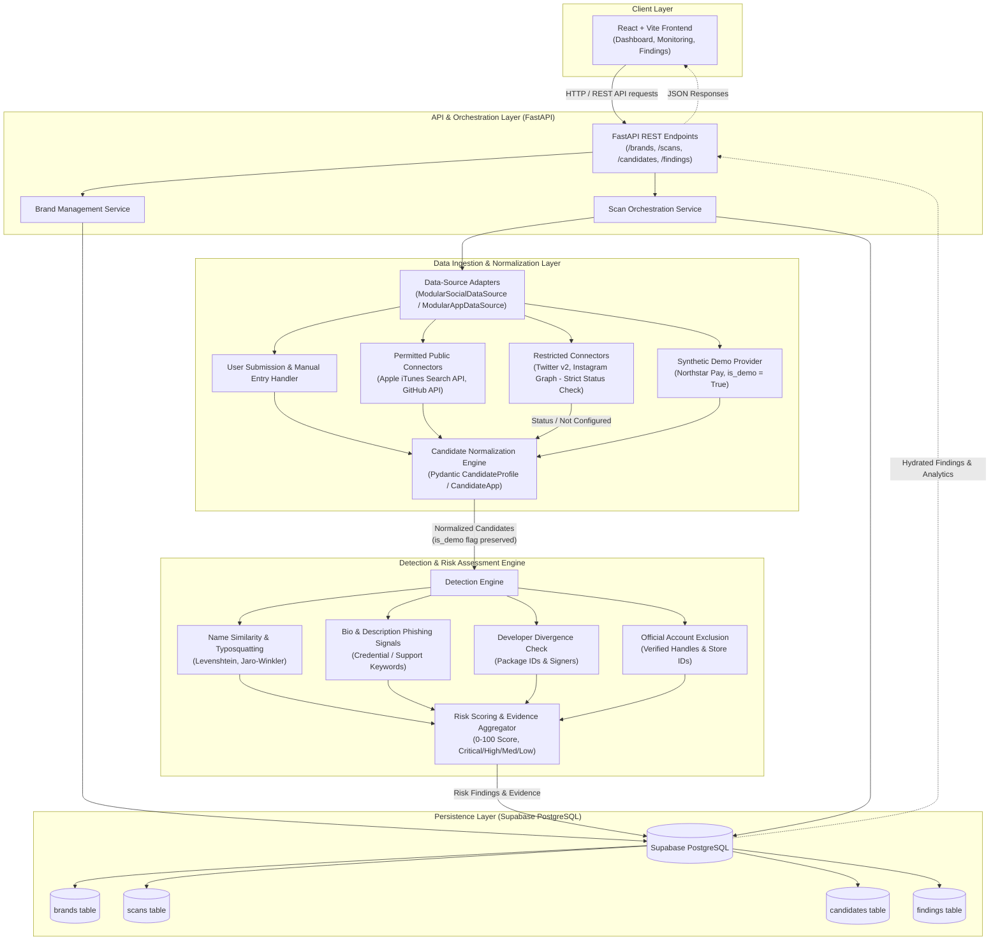
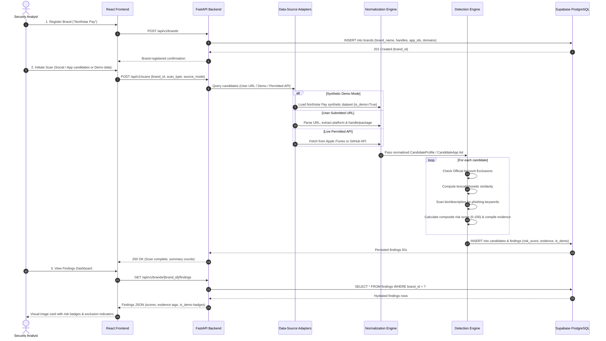

# SOC 360 - Architecture Specification

This document details the system architecture of **SOC 360**, a digital risk protection platform designed to identify brand impersonation across social networks and mobile application stores.

---

## High-Level Architecture Diagram

---

## Detailed Data Flow Sequence

---

## System Components & Responsibilities

### 1. React Frontend Layer
- **Tech Stack**: React 18, Vite, Tailwind CSS, Lucide Icons.
- **Responsibilities**:
  - Brand onboarding form (collecting registered domains, official social handles, and app package IDs).
  - Monitoring view for submitting suspect profile URLs, application store links, or triggering demo scans.
  - Interactive Findings dashboard rendering risk cards, similarity percentages, and evidence badges.
  - Visual indicators distinguishing **Demo Records** (`is_demo = True`) from **Live/User Findings** (`is_demo = False`).

### 2. FastAPI Backend & Orchestration
- **Tech Stack**: FastAPI, Uvicorn, Pydantic v2.
- **Responsibilities**:
  - Request validation, route dispatching, and error handling.
  - Brand service managing brand profile definitions.
  - Scan coordinator orchestrating candidate retrieval, passing candidates to detection, and committing findings to Supabase.
  - CORS configuration enabling frontend communication across deployed origins.

### 3. Data-Source Adapters & Normalization
- **Tech Stack**: Python, HTTPX, Pydantic.
- **Responsibilities**:
  - **Modular Architecture**: Separate adapters for social media (`ModularSocialDataSource`) and app stores (`ModularAppDataSource`).
  - **URL Parsing**: Extracting canonical usernames, platform types, and store bundle IDs from raw user input.
  - **Permitted Public APIs**: Managing official endpoints (Apple iTunes Search API, GitHub Public User API) with rate limit monitoring.
  - **Transparent Connector Status**: When credentials for restricted platforms (X/Twitter, Instagram) are missing, returning `DataSourceStatus.NOT_CONFIGURED` without fabricating results.
  - **Synthetic Demo Feed**: Supplying rich synthetic records for the fictional brand *Northstar Pay*, enforcing `is_demo = True`.

### 4. Detection Engine
- **Responsibilities**:
  - **Official Exclusion**: Matches candidates against registered handles/package IDs. If matched, flags candidate as `OFFICIAL` and exempts it from alert notifications.
  - **Lexical & Phonetic Similarity**: Evaluates Levenshtein distance, Jaro-Winkler metrics, and token-sort similarity against brand variations (e.g., `northstarpaay` vs. `Northstar Pay`).
  - **Combosquatting Detection**: Detects brand names concatenated with sensitive terms (`support`, `care`, `wallet`, `helpdesk`, `bonus`).
  - **Semantic Risk Signals**: Evaluates bio text and descriptions for credential harvesting terms (`direct message`, `PIN`, `unlock`, `recovery`).
  - **Evidence Generation**: Emits an auditable list of matched rules and contribution weights explaining why a candidate was flagged.

### 5. Persistence Layer (Supabase PostgreSQL)
- **Tech Stack**: Supabase PostgreSQL 15, Row-Level Security (RLS).
- **Schema Tables**:
  - `brands`: Stores legal brand names, official domains, registered handles, and official package IDs.
  - `scans`: Tracks scan execution history, initiator, timestamp, and status.
  - `candidates`: Stores normalized candidate profiles and applications with the `is_demo` boolean flag.
  - `findings`: Stores risk scores, severity levels (`CRITICAL`, `HIGH`, `MEDIUM`, `LOW`, `OFFICIAL`), evidence JSON arrays, and resolution statuses (`new`, `under_review`, `confirmed_phish`, `dismissed`).

---

## Security Boundaries & Error Handling

| Boundary / Domain | Security Control | Operational Error Handling |
| :--- | :--- | :--- |
| **User Input** | Pydantic validation on all URLs, schemes (HTTP/HTTPS only), and string lengths. Prevents injection and buffer overflows. | Returns HTTP 422 Unprocessable Entity with descriptive field validation messages. |
| **API Credentials** | External API tokens (`TWITTER_BEARER_TOKEN`, `INSTAGRAM_ACCESS_TOKEN`, `SUPABASE_KEY`) are read strictly from environment variables. Never hardcoded or logged. | Missing credentials return `DataSourceStatus.NOT_CONFIGURED`. Execution continues gracefully via alternative sources. |
| **Rate Limiting** | Inspects upstream HTTP response headers (`x-ratelimit-remaining`, HTTP 429). Connectors implement non-blocking backoff. | Emits `RateLimitError` or returns `DataSourceStatus.RATE_LIMITED` to backend controller. |
| **Database Access** | Parameterized queries via Supabase client / PostgreSQL driver. Sensitive keys isolated in backend environment. | Connection retry logic with timeout guards prevents request hangs. |
| **Data Integrity** | Strict enforcement of `is_demo` boolean flag across all models. Database schema rejects NULL values for `is_demo`. | Prevents accidental misattribution of synthetic demo data in production environments. |
